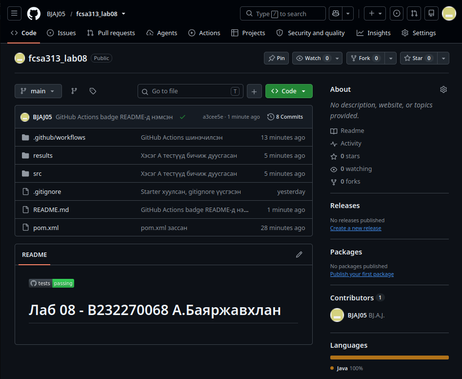

[](https://github.com/BJAJ05/fcsa313_lab08/actions/workflows/test.yml)

# Лаб 08 - B232270068 А.Баяржавхлан

## Туршилтын орчин

Java:
```
openjdk version "21.0.12.1" 2026-08-18
OpenJDK Runtime Environment (build 21.0.12.1+1-1-24.04.4-Ubuntu)
OpenJDK 64-Bit Server VM (build 21.0.12.1+1-1-24.04.4-Ubuntu, mixed mode, sharing)
```

Maven:
```
Apache Maven 3.8.7
Maven home: /usr/share/maven
Java version: 21.0.12.1, vendor: Ubuntu, runtime: /usr/lib/jvm/java-21-openjdk-amd64
Default locale: en_US, platform encoding: UTF-8
OS name: "linux", version: "6.8.0-147-generic", arch: "amd64", family: "unix"
```

OpenJDK 21 суулгасан тул `pom.xml`-д засвар хийсэн.

Maven-с гарсан үр дүнгийн файлд ANSI форматын escape sequence оруулахгүй тулд `ansi2txt` ашигласан.
```bash
mvn test 2>&1 | ansi2txt | tee results/mvn-test.txt
```

## Нэгжийн тестүүд, үр дүн

JUnit болон Mockito ашиглан лабораторийн удирдамжид өгөгдсөн 8 тестийг хэрэгжүүлсэн. Тестийг ажиллуулахад parameterized тест бичсэн байсан тул `mvn test` коммандаар 10 тест ажилласан гэж гарч ирсэн.

[results/mvn-test.txt](results/mvn-test.txt)

JUnit-ийн MockitoExtension нь шаардлагагүй stub-ыг зөвшөөрдөггүй default тохиргоотой байдаг учраас parameterized тестэд `lenient()` ашиглах шаардлага гарсан. Жишээ нь оюутан байхгүй (`exists=false`) гэсэн параметртэй үед `courseExists()` болон `prerequisites()` методуудын stub дуудагдахгүй, `UnnecessaryStubbingException` шидэх учир `lenient()` буюу "зөөлрүүлэлт" хийх хэрэгтэй.


## Мутацийн туршилт

| Мутант | Кодод хийсэн түр өөрчлөлт             | Унасан тест | Failures | Үр дүн                                                 |
| ------ | ------------------------------------- | ----------- | -------: | ------------------------------------------------------ |
| 1      | Идэвхгүй оюутны шалгалтыг хассан      | A3, A8      |        2 | [mvn-test-mutant-1.txt](results/mvn-test-mutant-1.txt) |
| 2      | `saveRegistration()` дуудалтыг хассан | A1, A5      |        2 | [mvn-test-mutant-2.txt](results/mvn-test-mutant-2.txt) |
| 3      | `courseId == null` шалгалтыг хассан   | A6          |        1 | [mvn-test-mutant-3.txt](results/mvn-test-mutant-3.txt) |

3 дахь мутаци туршилтыг хийхэд тест унаагүйгээс A6 тестээ дутуу бичснээ мэдсэн.

Анх зөвхөн `studentId`-г null эсэхийг шалгадаг байдлаар бичсэн байснаа засаж, `courseId`-г мөн шалгадаг болгосон. Үүний дараа мутаци туршилт хийхэд A6 тест унасан.

## GitHub Actions

Лекц дээр өгөгдсөн GitHub Actions-ын файлыг OpenJDK 21 болон Actions-ын үйлдлүүдийн шинэ хувилбарыг ашиглахаар тохируулж ашигласан.




## Дүгнэлт

Энэ лабораторийн ажлаар Mockito ашиглан mock объект бүхий нэгжийн тест бичиж, бичсэн тестээ мутацийн туршилтаар баталгаажууллаа.

Mock объект нь урьдчилан тохируулсан хариу буцаахаас гадна тухайн объект руу ямар дуудалт хийгдсэнийг шалгах боломжтой байдаг бол fake объект нь хялбаршуулсан боловч бодитоор ажиллах хэрэгжүүлэлт юм. Жишээлбэл, fake өгөгдлийн сан нь өгөгдлийг санах ойд хадгалж, бодит сангийн ажиллагааг орлож болно.

Mock объектыг өгөгдлийн сан, и-мэйл илгээгч, сүлжээ зэрэг тестлэж буй классын гаднах хамаарлуудыг орлуулахад ашиглах нь тохиромжтой. Харин тестлэж буй классын өөрийн логик болон энгийн өгөгдлийн объектуудыг шаардлагагүйгээр mock хийж болохгүй.

verify-г хэтрүүлж, хэрэгжүүлэлтийн дотоод дуудалт бүрийг шалгавал кодыг refactor хийх үед логик, үр дүн өөрчлөгдөөгүй байсан ч тестүүд эвдрэх эрсдэлтэй.

Мутацийн туршилтаар бичсэн тестийнхээ дутагдлийг илрүүлж, сайжруулсан. Мөн GitHub Action ашиглан CI хэрэгжүүлсэн.

